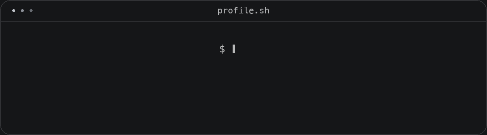
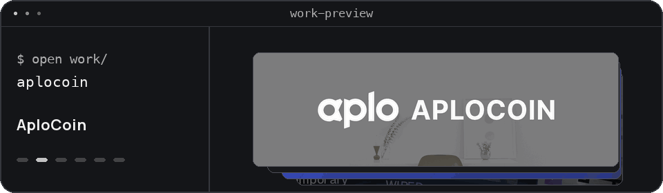
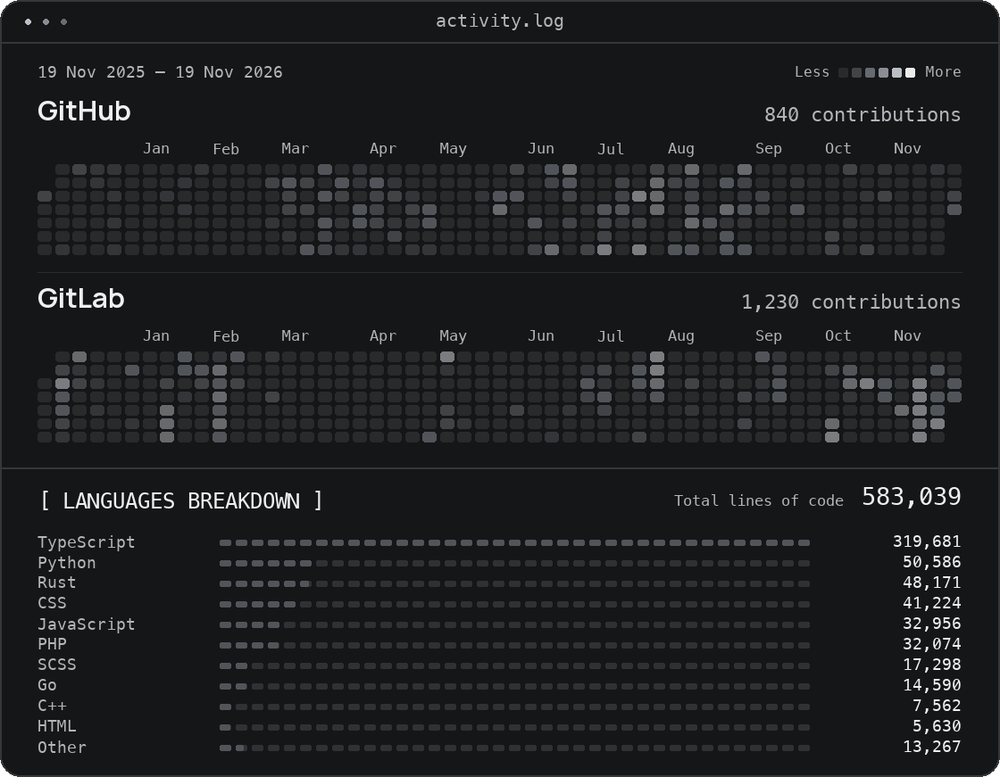

  <picture>
    <source media="(prefers-reduced-motion: reduce)" srcset="assets/banners/ascii-console-coffee.png">
    
  </picture>

I’m Artem, CTO at [InterFuse](https://interfuse.agency/). I set the technical direction for client projects and lead the engineering team that delivers them. I work with clients to decide what to launch first and how it should fit into the way their business already operates.

## How InterFuse can help

- **Launch a web or mobile product.** We design and build web apps, customer portals, and iOS and Android apps.
- **Replace manual work with software.** We turn spreadsheets and email handoffs into a shared workflow for approvals, permissions, and reporting.
- **Sell online and connect your operations.** We build storefronts and connect checkout and payments to fulfillment and CRM.
- **Improve an existing product.** We fix performance problems, replace unreliable integrations, and help teams migrate or maintain their applications.

  

  <a href="https://interfuse.agency/work">
    <picture>
      <source media="(prefers-reduced-motion: reduce)" srcset="assets/case-variants/08-tmux-stack.png">
      
    </picture>
  </a>

## Engineering stack

| Area | Technologies |
| --- | --- |
| **Web applications** |       |
| **Mobile &amp; desktop apps** |       |
| **Backend services &amp; APIs** |         |
| **Python services &amp; automation** |         |
| **Systems, firmware &amp; IoT** |          |
| **Blockchain &amp; Web3** |       |
| **Databases &amp; storage** |         |
| **Infrastructure &amp; deployment** |         |

Additional tools

| Area | Technologies |
| --- | --- |
| **UI, state &amp; forms** |         |
| **Data processing &amp; machine learning** |       |
| **Search &amp; data access** |        |
| **Testing &amp; code quality** |       |
| **Web frameworks &amp; UI libraries** |       |
| **Build tooling** |       |
| **Graphics &amp; native UI** |       |
| **Bots &amp; integrations** |        |
| **Additional languages &amp; frameworks** |      |
| **E-commerce &amp; CMS** |            |

  <picture>
    <source media="(prefers-reduced-motion: reduce)" srcset="assets/activity-board.png">
    
  </picture>

